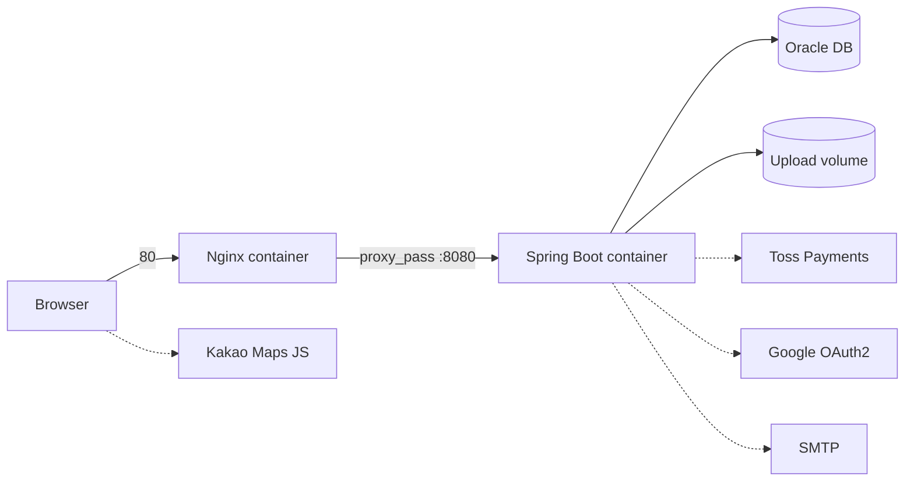

# Oneday Class

> 원데이 클래스 예약·결제 플랫폼 — 수강생은 클래스를 탐색하고 예약하며, 작가(Creator)는 클래스를 등록·운영·정산하고, 관리자는 전체 서비스를 관리합니다.

Spring Boot 기반의 서버 사이드 렌더링(Thymeleaf) 웹 애플리케이션이며, Docker + Nginx로 AWS EC2에 배포합니다.

---

## 목차

- [주요 기능](#주요-기능)
- [기술 스택](#기술-스택)
- [시스템 구성](#시스템-구성)
- [프로젝트 구조](#프로젝트-구조)
- [시작하기](#시작하기)
- [배포](#배포)
- [테스트](#테스트)
- [주요 경로](#주요-경로)

---

## 주요 기능

### 수강생 (일반 회원)

| 영역 | 내용 |
| --- | --- |
| 회원 | 회원가입(아이디·이메일 중복 확인, 이메일 인증번호), 일반 로그인, **Google OAuth2 로그인**, 아이디 찾기, 임시 비밀번호 메일 발급, 회원 탈퇴 |
| 탐색 | 메인, 상위 카테고리(뷰티·베이킹·액티비티), 카테고리별 클래스, 오늘/이번 주 클래스, 클래스·작가 검색 |
| 지도 | **Kakao 지도** 기반 위치별 클래스 조회 |
| 상세 | 클래스 상세(커리큘럼·준비물·일정·리뷰), 작가 상세, 환불 정책 |
| 예약·결제 | 일정 선택 → **토스페이먼츠** 결제 승인 → 예약 확정, 구매 내역 조회, 예약 취소 |
| 마이페이지 | 북마크, 리뷰 작성, 1:1 문의, 공지사항, 프로필 이미지·비밀번호 변경 |

### 작가 (Creator)

| 영역 | 내용 |
| --- | --- |
| 접근 | 로그인 후 작가 프로필을 완성해야 작가 메뉴 이용 가능 (인터셉터로 검증) |
| 클래스 등록 | 단계별 등록: 기본 정보 → 위치 → 일정 → 상세 → 추가 상세 → 커리큘럼 → 제출 |
| 승인 | 관리자 승인 요청, 반려 사유 확인 후 수정·재제출 |
| 운영 | 클래스 공개/비공개/마감, 일정 추가·재오픈·취소, 참여 인원 관리, 항목별 수정 |
| 대시보드 | 오늘의 클래스, 최근 예약, 예약 추이 차트, 알림 |
| 리뷰·문의 | 리뷰 답글 작성/수정/삭제, 관리자 대상 문의(QnA) |
| 정산 | 매출 조회, 정산 가능 금액 계산, 정산 계좌·통장 사본 등록, 정산 신청, **엑셀 다운로드** |

### 관리자 (Admin)

- 별도 Security 필터 체인(`/admin/**`)과 로그인 페이지 사용, `ADMIN` 권한만 접근
- 대시보드(월별 예약 통계), 회원 관리, 작가 관리, 클래스 관리·승인, 문의 답변, 공지사항 관리, 관리자 정보 수정(비밀번호 재확인)

### 기타

- **예약 상태 자동 갱신**: 서버 기동 직후 1회, 이후 10분마다 지난 예약을 '수강완료'로 변경 (`ReservationScheduler`)
- **개인정보 암호화**: AES 유틸(`AESUtil`)을 통한 민감 정보 처리, 비밀번호는 BCrypt 해시

---

## 기술 스택

| 구분 | 사용 기술 |
| --- | --- |
| Language | Java 17 |
| Framework | Spring Boot 3.2.5 (Web, Validation, Security, OAuth2 Client, Mail, Scheduling) |
| View | Thymeleaf, HTML/CSS/JavaScript |
| Persistence | MyBatis 3.0.3 (XML Mapper), Oracle Database (ojdbc11) |
| 외부 연동 | 토스페이먼츠(결제 승인·취소), Google OAuth2, Kakao Maps, SMTP(메일) |
| Build | Maven (Maven Wrapper 포함) |
| Infra | Docker, Docker Compose, Nginx, AWS EC2 |
| Etc. | Lombok, Spring Boot DevTools |

---

## 시스템 구성



- **Nginx**와 **Spring Boot(WAS)** 를 각각 별도 컨테이너로 분리하고, 같은 Docker 네트워크(`app-network`)에서 서비스 이름(`spring-app`)으로 통신합니다.
- 외부에는 Nginx의 80 포트만 노출하고, Spring Boot는 `expose: 8080`으로 내부 네트워크에만 열려 있습니다.
- 업로드 파일은 호스트 디렉터리(`/home/ubuntu/upload`)를 컨테이너의 `/app/upload`에 마운트해 컨테이너 재생성과 무관하게 유지됩니다.

---

## 프로젝트 구조

```
Oneday-Class/
└── oneday_class/
    ├── Dockerfile
    ├── docker-compose.yml
    ├── nginx/default.conf
    ├── pom.xml
    └── src/
        ├── main/
        │   ├── java/kr/co/oneclass/
        │   │   ├── admin/        # 관리자 (login, member, writer, onedayclass, inquiry, notice, dashboard, info)
        │   │   ├── author/       # 작가 (classbasic, classmanage, classapproval, dashboard,
        │   │   │                 #        review, inquiry, settlement, profile, common)
        │   │   ├── member/       # 회원가입·로그인·OAuth2·이메일 인증
        │   │   ├── payment/      # 결제 (토스페이먼츠 승인)
        │   │   ├── purchase/     # 구매 내역·예약 취소
        │   │   ├── category/ main/ search/ map/ classDetail/ creatorDetail/
        │   │   ├── bookmark/ review/ inquiry/ notice/ mypage/ profile/
        │   │   ├── config/       # SecurityConfig, WebConfig
        │   │   └── common/       # AESUtil, ReservationScheduler, 공통 DTO
        │   └── resources/
        │       ├── mapper/       # MyBatis XML Mapper (도메인별)
        │       ├── templates/    # Thymeleaf 템플릿
        │       ├── static/       # css / js / images
        │       └── application*.properties
        └── test/                 # 서비스·컨트롤러 단위 테스트
```

각 도메인은 `Controller → Service → DAO → Mapper(XML)` 계층으로 구성됩니다.

---

## 시작하기

### 요구 사항

- JDK 17
- Oracle Database (접속 가능한 인스턴스)
- (선택) Docker / Docker Compose

### 1. 저장소 클론

```bash
git clone <repository-url>
cd Oneday-Class/oneday_class
```

### 2. 설정 파일 작성

민감한 값은 저장소에 커밋하지 않고 **`application-secret.properties`** 에 분리합니다. (`.gitignore` 및 JAR 패키징에서 제외됨)
`dev` 프로파일은 아래 위치의 파일을 자동으로 읽습니다.

- `./application-secret.properties`
- `./src/main/resources/application-secret.properties`

```properties
# Oracle
spring.datasource.url=jdbc:oracle:thin:@<HOST>:1521/<SERVICE_NAME>
spring.datasource.username=<DB_USER>
spring.datasource.password=<DB_PASSWORD>

# 토스페이먼츠 (시크릿 키)
toss.secret-key=<TOSS_SECRET_KEY>

# Kakao 지도 (JavaScript 키)
oneday.maps.kakao-app-key=<KAKAO_APP_KEY>

# Google OAuth2
spring.security.oauth2.client.registration.google.client-id=<GOOGLE_CLIENT_ID>
spring.security.oauth2.client.registration.google.client-secret=<GOOGLE_CLIENT_SECRET>
spring.security.oauth2.client.registration.google.scope=profile,email

# 메일 (인증번호 · 임시 비밀번호 발송)
spring.mail.host=<SMTP_HOST>
spring.mail.port=587
spring.mail.username=<MAIL_USER>
spring.mail.password=<MAIL_PASSWORD>
spring.mail.properties.mail.smtp.auth=true
spring.mail.properties.mail.smtp.starttls.enable=true
```

| 설정 | 설명 | 기본값 |
| --- | --- | --- |
| `file.upload-dir` | 업로드 파일 저장 경로. 환경변수 `FILE_UPLOAD_DIR`로 덮어쓸 수 있음 | `uploads/` |
| `server.servlet.session.cookie.same-site` | 외부 결제 페이지에서 리다이렉트되어도 세션이 유지되도록 `lax` | `lax` |

> `application.properties`의 기본 프로파일은 `prod`이고, 저장소에는 `application-dev.properties`만 포함되어 있습니다. 로컬에서는 `dev` 프로파일을 명시해 실행하세요.

### 3. 실행

```bash
# 개발 모드
./mvnw spring-boot:run -Dspring-boot.run.profiles=dev
```

Windows는 `mvnw.cmd`를 사용합니다. 기동 후 http://localhost:8080 에서 확인할 수 있습니다.

### 4. 빌드

```bash
./mvnw clean package
# → target/oneday_class-1.0.jar
```

---

## 배포

AWS EC2에서 Docker Compose로 Nginx와 Spring Boot를 함께 실행합니다.

```bash
# 1) JAR 빌드 (Dockerfile이 target/oneday_class-1.0.jar 를 복사함)
./mvnw clean package -DskipTests

# 2) 업로드 디렉터리 준비
mkdir -p /home/ubuntu/upload

# 3) 컨테이너 빌드 및 실행
docker compose up -d --build

# 로그 확인
docker compose logs -f spring-app
```

| 서비스 | 이미지 | 역할 |
| --- | --- | --- |
| `spring-app` | `eclipse-temurin:17-jre-alpine` | Spring Boot WAS (8080, 내부 전용) |
| `nginx-proxy` | `nginx:alpine` | 리버스 프록시 (80), `Host`·`X-Forwarded-*` 헤더 전달 |

### 배포 시 참고

- **파일 경로 대소문자**: 로컬(Windows)과 달리 Linux 컨테이너는 파일명·경로의 대소문자를 구분합니다. 템플릿 경로나 업로드 경로의 대소문자가 다르면 배포 환경에서만 오류가 날 수 있습니다.
- **업로드 디렉터리**: `FILE_UPLOAD_DIR=/app/upload/` 경로가 호스트 볼륨(`/home/ubuntu/upload`)에 마운트되어 있어야 합니다.
- **운영 설정**: `prod` 프로파일 및 시크릿 값은 저장소 밖에서 주입해야 합니다. 환경변수 또는 컨테이너에 마운트한 외부 설정 파일을 사용하세요.

---

## 테스트

```bash
./mvnw test
```

작가 영역(클래스 관리·등록, 정산, 리뷰, 대시보드, 승인, 프로필, 접근 제어)과 토스페이먼츠 취소 클라이언트 등에 대한 테스트가 포함되어 있습니다.

---

## 주요 경로

| 구분 | 경로 | 설명 |
| --- | --- | --- |
| 일반 | `/`, `/main`, `/category`, `/search`, `/map` | 메인·탐색·검색·지도 |
| 일반 | `/classDetail`, `/creatorDetail` | 클래스·작가 상세 |
| 회원 | `/member/login`, `/member/signUp`, `/member/findId`, `/member/findPassword` | 인증·계정 |
| 결제 | `/payment`, `/payment/paymentComplete`, `/payment/paymentFail` | 결제 흐름 |
| 마이페이지 | `/mypage`, `/mypage/purchase`, `/mypage/bookmark`, `/mypage/inquiry`, `/mypage/notice`, `/mypage/review/write` | 수강생 메뉴 |
| 작가 | `/author`, `/author/classes`, `/author/classes/register-guide`, `/author/sales`, `/author/settlements`, `/author/reviews`, `/author/qna` | 작가 센터 |
| 관리자 | `/admin/login`, `/admin/dashboard`, `/admin/members`, `/admin/writer`, `/admin/onedayclass`, `/admin/inquiries`, `/admin/notices` | 관리자 페이지 |

---

## 보안 메모

- 비밀번호는 BCrypt로 해시하며, 관리자 영역은 별도의 Security 필터 체인(`@Order(1)`, `/admin/**`)으로 분리되어 있습니다.
- 관리자 계정은 동시 세션 1개로 제한하고, 로그인 시 세션 고정 공격을 방어(`migrateSession`)합니다.
- 작가 영역은 `AuthorAccessInterceptor`가 로그인 여부와 작가 프로필 완성 여부를 검증합니다.
- 비밀 설정(`application-secret.properties`)은 Git과 배포 JAR 모두에서 제외됩니다.
